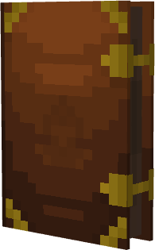

# yaronIsWinning's Blockbench Portfolio
A portfolio used to share **my** works using Github.

## Minecraft models
### Relic Guitar - 
A guitar made for the [Sakura Falls Minecraft server](view https://github.com/SakuraFalls-Server/SakuraFalls-Denizen-Scripts.git) inspired by [Striped Series Frankenstein™ "Frankie](https://www.evhgear.com/gear/shape/strat/striped-series-frankenstein-frankie/5107900503).

### Ancient Book - 
An random book I've decided to model from a random picture on Google.

