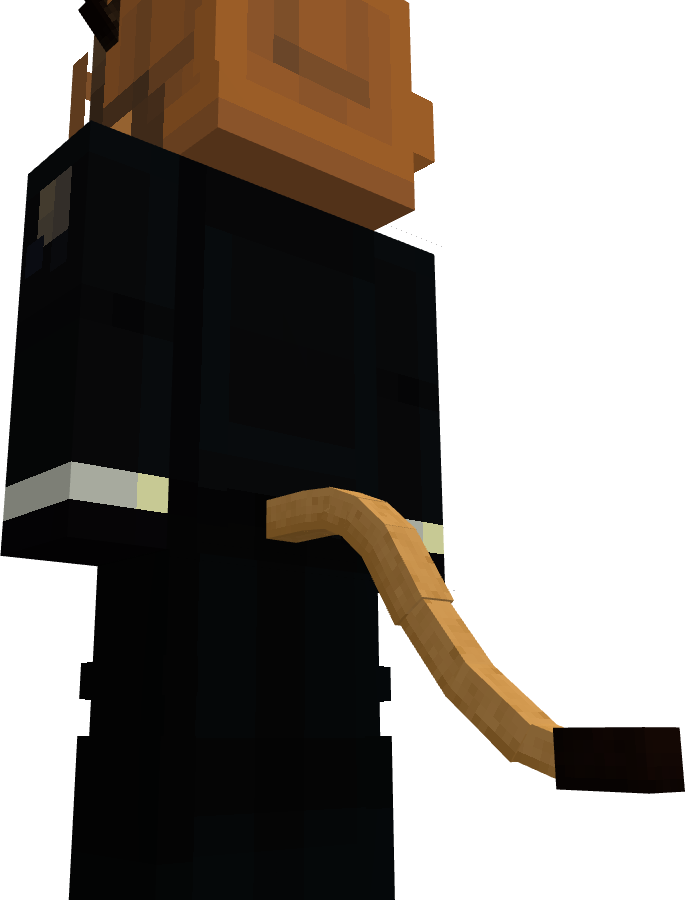
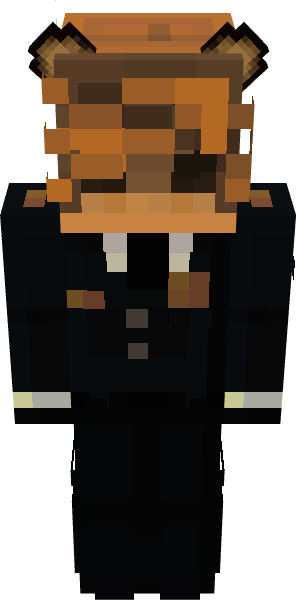
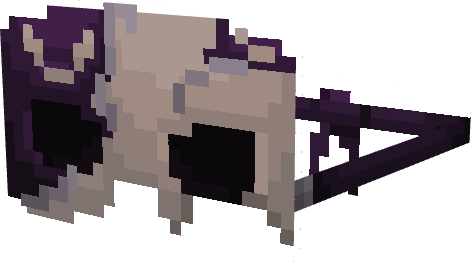
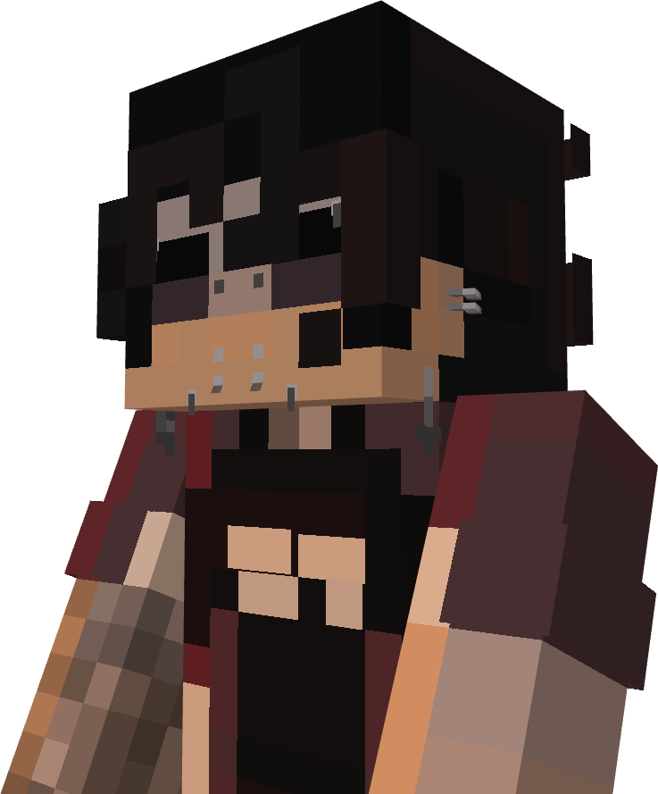
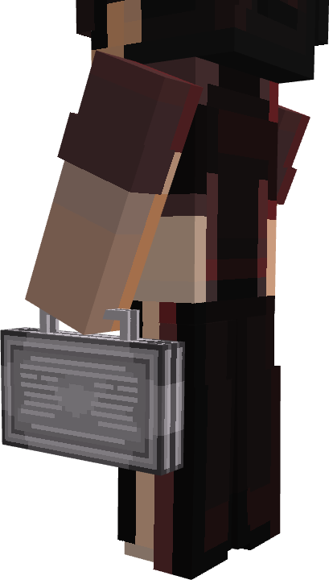
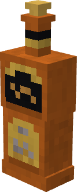

# yaronIsWinning's Blockbench Portfolio
A portfolio used to share **my** works using Github.

## Minecraft models
### Relic Guitar - 
A guitar made for the [Sakura Falls Minecraft server](https://github.com/SakuraFalls-Server/SakuraFalls-Denizen-Scripts.git) inspired by [Striped Series Frankenstein™ "Frankie](https://www.evhgear.com/gear/shape/strat/striped-series-frankenstein-frankie/5107900503).

### Ancient Book - 
A random book I've decided to model from a random picture on Google.

### Lion (Furry :3) - 
A lion tail and ears I've made for [Figura](https://figuramc.org/).

 

### Massacred Mask - 
A mask I made for the [Sakura Falls Minecraft server](https://github.com/SakuraFalls-Server/SakuraFalls-Denizen-Scripts.git) requested by a player.

### Piercing Set - 
A piercing set I made for the [Sakura Falls Minecraft server](https://github.com/SakuraFalls-Server/SakuraFalls-Denizen-Scripts.git) requested by a player.

### Metal Briefcase - 
A Metal Briefcase I made for the [Sakura Falls Minecraft server](https://github.com/SakuraFalls-Server/SakuraFalls-Denizen-Scripts.git), but was never used.

### Brandy Bottle - 
A bottle of brandy I made for the [Sakura Falls Minecraft server](https://github.com/SakuraFalls-Server/SakuraFalls-Denizen-Scripts.git), alongside many other alcohol bottles, but this one was my favorite.

